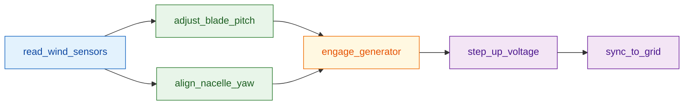
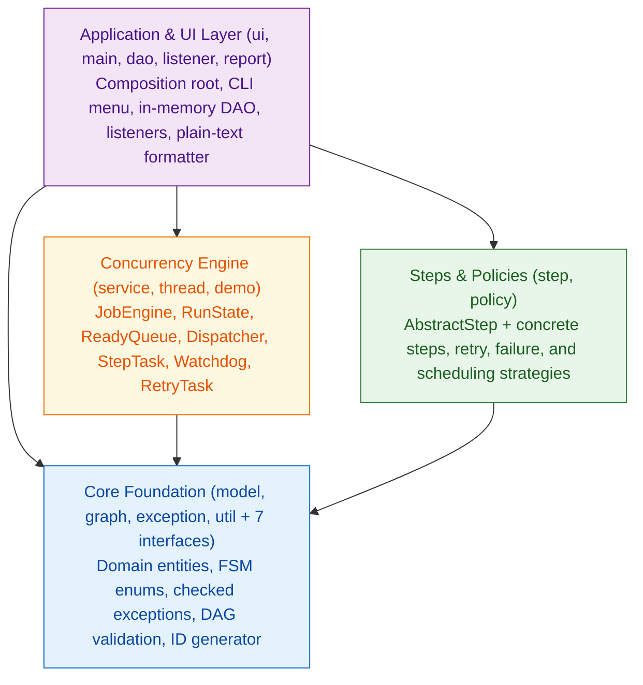

# SteadyState


SteadyState is a dependency-aware job orchestrator written in pure Core Java SE. It models multi-step workflows as Directed Acyclic Graphs (DAGs), validates dependencies before execution, runs independent steps concurrently across a worker thread pool, retries transient failures with configurable backoff, interrupts timed-out tasks, and propagates permanent failures according to pluggable policies.

## Case Study: Windmill Electricity Generation Pipeline

Consider a wind turbine control pipeline that converts wind into grid-ready electricity. Some mechanical adjustments must happen in sequence, while others can safely execute in parallel once sensor data is available:

1. `read_wind_sensors` measures wind speed and direction.
2. `adjust_blade_pitch` and `align_nacelle_yaw` run in parallel to position the rotor and nacelle.
3. `engage_generator` waits until both pitch and yaw adjustments finish before spinning up AC power generation.
4. `step_up_voltage` raises output voltage through the transformer.
5. `sync_to_grid` matches grid frequency and dispatches power.



With SteadyState:
- **Parallelism**: `adjust_blade_pitch` and `align_nacelle_yaw` run simultaneously on separate worker threads.
- **Retries**: If `adjust_blade_pitch` hits a transient actuator error, the engine backs off on a timer thread and retries without blocking other workers.
- **Timeouts**: If a hardware step hangs past its configured `timeoutSeconds`, the watchdog interrupts the worker and records a `StepTimeoutException`.
- **Failure Isolation**: If `adjust_blade_pitch` fails permanently, `SkipDependentsPolicy` skips `engage_generator`, `step_up_voltage`, and `sync_to_grid` so power is never dispatched without proper blade alignment, while `align_nacelle_yaw` completes independently.

### Defining and Running the Pipeline in Java

```java
import dao.InMemoryRunDAO;
import dao.RunDAO;
import listener.ConsoleRunListener;
import model.Job;
import model.JobRun;
import model.StepDefinition;
import policy.AlphabeticalStrategy;
import policy.FixedDelayRetryPolicy;
import policy.SkipDependentsPolicy;
import report.PlainTextReportFormatter;
import service.JobEngine;
import step.ComputeStep;
import step.PrintStep;

import java.util.Arrays;
import java.util.Collections;

Job windJob = new Job("wind-turbine-generation");
windJob.addStep(new StepDefinition(
        "read_wind_sensors", new PrintStep("read_wind_sensors", 400),
        Collections.emptyList(), 2, 5));
windJob.addStep(new StepDefinition(
        "adjust_blade_pitch", new PrintStep("adjust_blade_pitch", 800),
        Collections.singletonList("read_wind_sensors"), 2, 10));
windJob.addStep(new StepDefinition(
        "align_nacelle_yaw", new ComputeStep("align_nacelle_yaw", 12),
        Collections.singletonList("read_wind_sensors"), 2, 10));
windJob.addStep(new StepDefinition(
        "engage_generator", new PrintStep("engage_generator", 600),
        Arrays.asList("adjust_blade_pitch", "align_nacelle_yaw"), 1, 10));
windJob.addStep(new StepDefinition(
        "step_up_voltage", new PrintStep("step_up_voltage", 500),
        Collections.singletonList("engage_generator"), 1, 10));
windJob.addStep(new StepDefinition(
        "sync_to_grid", new PrintStep("sync_to_grid", 400),
        Collections.singletonList("step_up_voltage"), 1, 10));

RunDAO dao = new InMemoryRunDAO();
JobEngine engine = new JobEngine(
        3,
        new FixedDelayRetryPolicy(500L),
        new SkipDependentsPolicy(),
        new AlphabeticalStrategy(),
        dao);
engine.addListener(new ConsoleRunListener());

JobRun run = engine.execute(windJob);
System.out.println(new PlainTextReportFormatter().format(run));
```

## Core Capabilities

- **Pre-execution DAG validation**: Rejects empty jobs, duplicate step IDs, self-dependencies, missing references, and cycles before allocating threads. Cycle detection runs Kahn's topological sort in $O(V + E)$ time.
- **Concurrent execution engine**: Uses a fixed-size `ExecutorService` worker pool, a dedicated `Dispatcher` thread, and a synchronized `ReadyQueue` backed by a `PriorityQueue` with `wait()` and `notifyAll()`.
- **Single-lock state management**: `RunState` coordinates step transitions, remaining dependency counts, and terminal completion under one monitor lock to prevent race conditions and lock-ordering deadlocks.
- **Guarded step lifecycle**: `StepStatus` and `StepRun` enforce legal state transitions (`PENDING`, `RUNNING`, `SUCCEEDED`, `FAILED`, `SKIPPED`) and throw `IllegalStateException` on invalid moves.
- **Non-blocking retries and timeouts**: A `ScheduledExecutorService` handles both retry backoff delays (`RetryTask`) and per-attempt timeout interrupts (`TimeoutWatchdog`).
- **Pluggable policies and observers**: Scheduling order, retry backoff, failure propagation, persistence (`RunDAO`), live event logging (`RunListener`), and report rendering (`ReportFormatter`) are all programmed against interfaces.

## Architecture

SteadyState is organized into four dependency layers. The execution engine depends strictly on foundation interfaces and domain models, with concrete policies, storage, and listeners wired at startup in `SteadyStateApplication`.



### Package Overview

| Package | Responsibility |
| :--- | :--- |
| `src/model` | Immutable workflow recipes (`Job`, `StepDefinition`, `StepResult`, `RunEvent`), mutable execution state (`JobRun`, `StepRun`), and lifecycle enums (`StepStatus`, `RunStatus`, `EventType`). |
| `src/graph` | Forward and reverse DAG adjacency lists, breadth-first downstream traversal, Kahn's cycle detection, and pre-execution job validation. |
| `src/exception` | Checked exception hierarchy rooted at `SteadyStateException` covering invalid jobs, cycles, execution errors, and timeouts. |
| `src/step` | `Step` contract, `AbstractStep` template method timing wrapper, and sample step implementations (`PrintStep`, `ComputeStep`, `FaultyStep`, `SlowStep`). |
| `src/policy` | Strategy interfaces and implementations for retry backoff, failure propagation, and ready-queue priority ordering. |
| `src/service` | Core execution runtime (`JobEngine`, `RunState`, `ReadyQueue`). |
| `src/thread` | Background worker and scheduler runnables (`Dispatcher`, `StepTask`, `TimeoutWatchdog`, `RetryTask`). |
| `src/dao` | `RunDAO` persistence contract and synchronized `InMemoryRunDAO`. |
| `src/listener` | `RunListener` observer interface with console and in-memory event log listeners. |
| `src/report` | `ReportFormatter` contract, `RunSummary` aggregation, and aligned plain-text report output. |
| `src/ui` & `src/main` | Built-in demo workflows, interactive console menu, and `SteadyStateApplication` entry point. |
| `src/util` & `src/demo` | Thread-safe run ID generator and a 4-thread race condition demonstration comparing unsynchronized vs. synchronized counters. |
| `test/` | Standalone verification checks (`PolicyCheck` and 20-run parallel `EngineStressCheck`). |

## Getting Started

### Prerequisites

- JDK 8 or later (`javac` and `java` on `PATH`)

### Compile

**Linux / macOS / Git Bash:**

```bash
javac -d out $(find src test -name "*.java")
```

**Windows (PowerShell):**

```powershell
javac -d out (Get-ChildItem src, test -Recurse -Filter *.java).FullName
```

### Run the Interactive CLI

```bash
java -cp out main.SteadyStateApplication
```

### Run Verification Checks

```bash
java -cp out policy.PolicyCheck
java -cp out service.EngineStressCheck
```

## CLI Menu and Sample Output

Running `SteadyStateApplication` starts an interactive menu with four built-in test pipelines, run history lookup, report viewing, and a multithreading race demo:

```text
=== STEADYSTATE ORCHESTRATOR (PHASE 1) ===
1. Run Cold-Chain Pipeline (Parallel DAG)
2. Run Flaky Pipeline (Retries)
3. Run Hanging Pipeline (Timeout & Skip)
4. Test Cyclic Job Rejection (Kahn's Check)
5. List Past Runs
6. View Run Report
7. Run Race Condition Demo
8. Exit
Choose:
```

Example report after executing a pipeline with a timed-out step:

```text
==== REPORT: hanging-pipeline (RUN-3) ====
STEP                 STATUS     ATTEMPTS  LAST ERROR
prepare              SUCCEEDED  1         -
slow_export          FAILED     2         slow_export timed out after 2s
notify               SKIPPED    0         -
Result: PARTIALLY_FAILED | succeeded 1, failed 1, skipped 1 | attempts 3 | 4820 ms
```

## Team Ownership

| Member | Role | Phase 1 Scope |
| :--- | :--- | :--- |
| **Bhavishya** | Lead A (Foundation & Graph) | Repository setup, 7 core interfaces, checked exceptions, domain models, FSM enums, graph validation, ID generator |
| **Mayank** | Lead B (Steps & Policies) | `AbstractStep`, 4 step implementations, 6 retry/failure/scheduling policies, `PolicyCheck` |
| **Pranav** | Lead C (Concurrency Engine) | `JobEngine`, `RunState`, `ReadyQueue`, 4 thread/runnable classes, race condition demo, `EngineStressCheck` |
| **Kritraj** | Lead D (Storage, Reporting & UI) | `InMemoryRunDAO`, event listeners, summary and report formatter, built-in sample jobs, `ConsoleMenu`, `SteadyStateApplication` |
